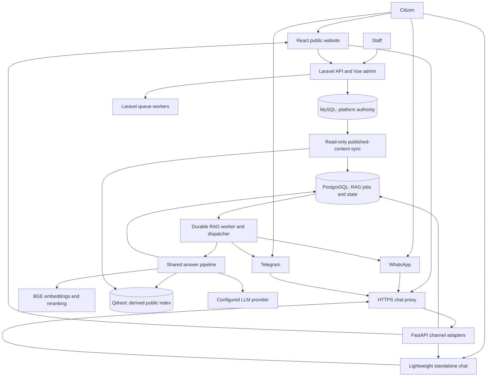

# Unified PromiseTracker architecture

Design agreed: 2026-10-09. Status: accepted target design; runtime implementation unverified.

## Scope and evidence

One platform serves the public website at `promisetracker.ng`, its embedded Mai Gaskiya chatbot, a lightweight standalone chat page at `chat.promisetracker.ng`, WhatsApp, and Telegram. Both browser chat surfaces and both messaging channels share one RAG service and evidence policy.

Initial chatbot scope is questions about published promises, exact official ratings, supporting updates, and linked evidence. Pledges, nominations, learners, and administration remain Laravel workflows. Private voter and learner records are excluded from retrieval. Future chatbot transactions require separately authorised product scope and authenticated application APIs.

This design merges the [platform architecture](../promisetracker_docs/architecture.md), [website data flow](../promisetracker_docs/data-flow.md), [RAG architecture](../ragdocs/architecture.md), [source-sync guide](../ragdocs/STARTUP_GUIDE.md), and [channel audit](../ragdocs/REMAINING_WORK_AND_CHANNEL_SETUP.md). They describe inspections at different times. Source and production behavior are unavailable in this workspace; documentary implementation claims need verification.

## Target topology

Browser clients retrieve completed answers through the proposed [job API](channel-contracts.md). Provider adapters deliver messaging replies. Laravel and RAG workers serve separate queues.

Preserve the Laravel modular monolith, React website, and separate Python RAG service. Unify contracts and evidence rather than merging PHP and Python runtimes. Keep the platform's existing Apache/systemd decision. RAG needs supervised API, durable worker/dispatcher, models, index, and synchroniser. If Compose is chosen for RAG, include its worker and sync explicitly; do not assume the documented Compose stack supervises them.

## Authority and trust boundaries

| Component | Owns | Boundary |
|---|---|---|
| Laravel + MySQL | Promise content, ratings, publication, meter/tenure/archive state, private platform records | RAG cannot write official content or ratings |
| React website | Public reading, engagement UI, embedded client | No database or privileged service credentials |
| FastAPI adapters | Verified ingress, validation, admission, authorised job reads | Same answer policy across channels |
| PostgreSQL | Durable inbox/outbox, isolated conversation state, cache/index metadata | Not canonical civic content or a copy of private tables |
| Qdrant | Rebuildable published-content retrieval index | Not authoritative ratings |
| Shared pipeline | Retrieval, ranking, grounding, citations, abstention | No publication or private-record access |
| Synchroniser | Approved extraction, tombstones, version activation, watermark | Read-only access to source |

Initially use a restricted read-only account over approved published-content views. Preserve promise publication/soft-delete filters and update publication/rejection filters. Project only necessary public fields. A later authenticated publication-event feed may improve invalidation while retaining MySQL authority.

Keep databases, Qdrant, and the model service private; expose APIs/webhooks through HTTPS. Verify WhatsApp signatures and Telegram webhook secrets before admission. Run Telegram polling or webhook ingress, never both simultaneously. Origin restrictions supplement session access checks and abuse controls; CORS alone is not authentication.

## Shared evidence rules

1. Preserve the official status and display label exactly: `not_yet_rated`, `in_the_works`, `stalled`, `compromised`, `kept`, or `broken`. Never infer ratings from article tone.
2. Treat evidence as untrusted text that cannot override instructions or request private-system access.
3. Require validated public source links for factual answers. Greetings, clarification, and abstention need no fabricated citation.
4. Apply politician, geography, category, status, meter, and tenure filters. Default to active/current meters; label historical/archived evidence explicitly. Clarify ambiguity.
5. Answer totals and rankings using complete filtered published data or a verified aggregate projection with a watermark. A top-k retrieval sample cannot establish population counts.
6. Abstain or clarify when evidence is missing, contradictory, withdrawn, or insufficient. Index failure must not trigger an ungrounded answer.
7. Adapters can change formatting or split messages, but must preserve ratings, caveats, freshness notices, and citations.

The target pipeline uses hybrid dense/sparse retrieval, evaluated BGE reranking, calibrated evidence gating, and grounded generation. Confirm actual wiring and calibrate thresholds on an adjudicated civic-question corpus. Do not copy conflicting score defaults or assert candidate counts from documentation alone. Select exact LLM/model identifiers from verified source/configuration and evaluation; Gemini/OpenAI/DeepSeek references do not prove a deployed choice.

## Freshness, synchronisation, and cache safety

Publication-to-query visibility should be within five minutes. Measure source change time through extraction, embedding, validation, activation, and cache invalidation. A five-minute polling sleep alone cannot meet that objective once processing is included. Start with a shorter configurable interval and measure the entire path under load.

Store each record's source update time separately from the successful source watermark covered by the active index. An old unchanged promise can be freshly verified. A process heartbeat does not prove coverage of source changes.

Use an incremental `(updated_at, id)` cursor with overlap and idempotent upserts after verifying source timestamp behavior. Handle unpublication/deletion explicitly. Hard deletes need tombstones, a change feed, or complete authoritative reconciliation. Never infer deletion from a partial/limited extraction. Remove withdrawn evidence from retrieval and invalidate dependent answers. If public eligibility cannot be established, suppress affected answers until checked against the authoritative public view.

Validate staged updates before version activation. Query version, retrieval snapshot, watermark, and cache eligibility must agree. Fallback retrieval must expose its own version/watermark and pass the same freshness policy.

| Evidence state | Response |
|---|---|
| Active watermark within five minutes | Grounded answer, citations, and an as-of time |
| Watermark older than five minutes | Disclose delay; do not claim a confirmed current rating; dated historical evidence is allowed only if still verified public |
| Unknown watermark, withdrawn evidence, unavailable index | Explain inability to verify current status; offer a validated source or retry |
| Saved/offline public page | Prominent saved/as-of labels; no live-status claim |

Answer-cache keys include corpus/index version, resolved filters/tenure, evidence policy, prompt, embedding, and model configuration. Recheck snapshot freshness and publication eligibility on cache reads. The documented one-hour TTL cannot override the five-minute freshness objective. Begin with exact normalised-query caching; enable semantic reuse only after entity/filter preservation is demonstrated. Bypass shared caching for context-dependent turns unless fully isolated context is keyed.

## Identity, durability, and operations

Scope conversations by channel plus opaque subject. Browser surfaces have separate sessions by default; website, WhatsApp, and Telegram histories are not linked automatically. Future linking requires explicit consent and verification. Use keyed pseudonyms in operational identifiers, minimise stored conversation text, encrypt retained text, and approve a finite retention policy before launch. Do not include private identity fields in retrieval evidence.

Persist accepted messages before acknowledging admission. Use scoped idempotency keys, leased workers, bounded retries, backpressure, and a durable outbox. Record provider message IDs. Deduplication prevents duplicate jobs, but external delivery can still be at-least-once when acknowledgements are lost; reconcile ambiguous sends instead of promising exactly-once delivery.

Monitor source/withdrawal lag, activation, queue age, admission latency, retrieval/model stages, provider errors, citation failures, cache effectiveness, and cost. Separate API liveness, ability to admit work, and ability to answer with fresh evidence. Alert on missed freshness objectives. Back up authoritative/operational databases, test restores, and document index rebuilds.

## Reconciled claims and open verification

| Existing conflict | Unified decision | Needed evidence |
|---|---|---|
| PostgreSQL called canonical versus platform MySQL | MySQL is civic authority; PostgreSQL owns RAG state | Actual source DB/schema and restricted extraction |
| Website calls external chatbot; ownership unknown | One shared service is target | Deployed ownership, routes, widget compatibility |
| RAG web endpoint versus standalone UI | API is documented; lightweight page is proposed | Locate/build browser client |
| Conflicting LLM identifiers | Configurable provider; choice unverified | Production config and evaluation |
| Older DeepSeek plan versus BGE architecture | BGE is target, older plan is historical | Verify reranker, score scale, candidate expansion |
| Sync called future versus documented watch command | Watch command documented, live scheduling unverified | Supervisor, cursor, tombstones, measured lag |
| Single process versus separate durable worker | Supervise API, worker/dispatcher, and sync | Actual systemd/Compose services and recovery |
| RAG lacks archive contract | Explicit current/historical meter and tenure | Source mapping, filters, archive evaluation |
| One-hour cache versus five-minute freshness | Cache eligibility follows snapshot/freshness | Invalidation and watermark enforcement |

Follow the [implementation plan](implementation-plan.md). The present deliverable is the merged target design; application integration and deployment require source access and verification.
