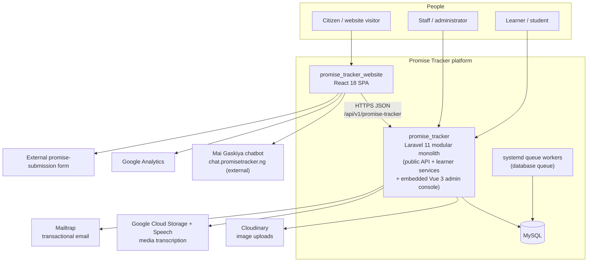
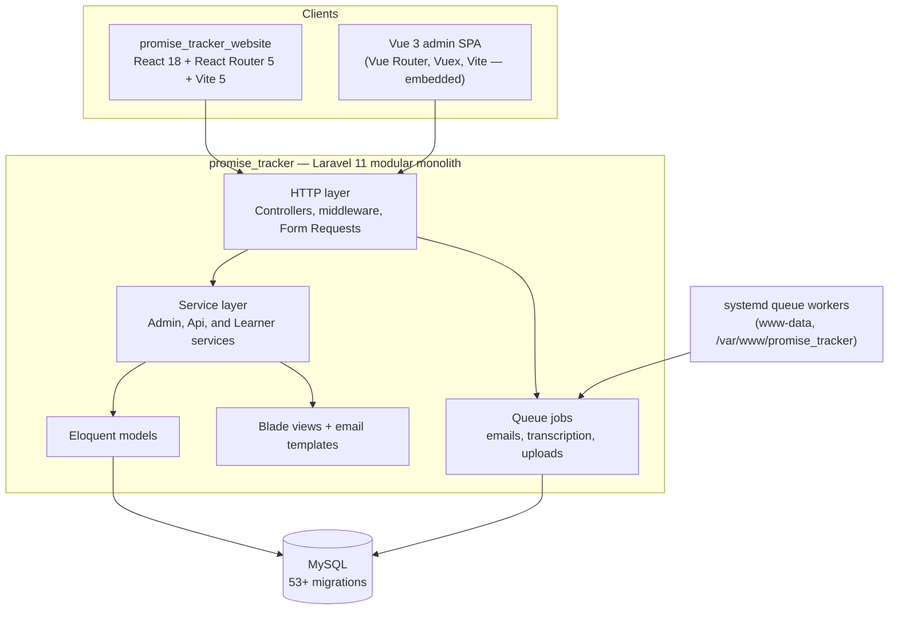
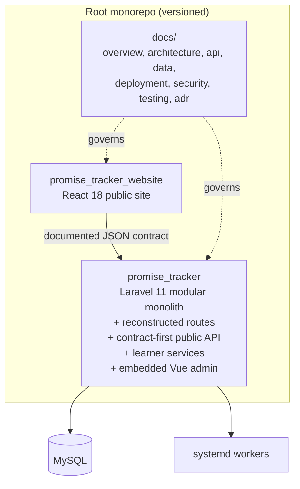

# Promise Tracker — Architecture

> The [unified architecture](../docs/architecture.md) governs the accepted website/RAG/WhatsApp/Telegram target as of 2026-10-09. The snapshot below remains historical platform evidence.

Accurate as of: 2026-09-10

This document describes the **current** architecture, the agreed **target** architecture, and the **gaps** between them. It covers both applications and their integration. Deep-dive documents live in [data-flow.md](data-flow.md), [api/](api/), [data/](data/), [deployment/](deployment/), [security/](security/), and [testing/](testing/) (see the [document map](README.md)).

## Canonical names

| Name | Meaning |
|---|---|
| `promise_tracker` | Laravel 11 backend + public API + learner services + embedded Vue 3 admin console |
| `promise_tracker_website` | React 18 public website (package name `advokc` — legacy) |

## Current state

### System context

### Component view

### Module map

| Domain | Responsibilities | Representative code |
|---|---|---|
| Promise tracking | Trackers (presidential, state, legislative), meters (`promise_tracker`, `promise_ring`), promises with six statuses, published updates, reminders | `app/Http/Controllers/Api/Promise/TrackedPromise.php`, `app/Services/Api/Promise/PromiseService.php`, `app/Models/Promise.php` |
| Voter engagement | Voter pledges (unique normalised phone, PVC status, consent), nominations (queued emails, max 5 per request / 10 unique), reminder contacts, meter subscribers | `app/Http/Controllers/Api/Promise/VoterPledgeController.php`, `app/Http/Controllers/Api/Promise/MeterSubscribers.php`, `app/Http/Requests/StoreVoterPledgeNominationsRequest.php` |
| Learning (LMS) | Learners, cohorts, courses, quizzes, instructors; student leaderboard | `app/Services/Learner/`, `app/Services/Api/Leaderboard/StudentService.php`, `app/Http/Controllers/Admin/Student/`, `app/Http/Controllers/Admin/Cohort/`, `app/Http/Controllers/Admin/Quiz/` |
| Identity & access | Admins/users, Sanctum token auth, Spatie roles/permissions | `app/Http/Controllers/Admin/Auth/Authenticate.php`, `app/Services/Admin/Auth/AuthService.php`, permission migrations |
| Media & transcription | Cloudinary uploads, Google Cloud Storage + Speech transcription, FFmpeg | `app/Traits/ImageTrait.php`, `app/Jobs/TranscribeAudio.php`, `app/Jobs/CompleteUploadJob.php` |
| Communications & ops | Mailtrap email, broadcast config (Pusher configured, log mode active), notifications, activity logs, analytics, jobs/cache/sessions | `app/Jobs/`, `app/Mail/`, `config/broadcasting.php` |

Background jobs today: `CompleteUploadJob`, `DeleteNotificationsJob`, `MeterSubscrberJob` (name as in code), `MigrateStudentsJob`, `SendPledgeReminderMessage`, `SendPromiseNotificationEmail`, `SendRejectionEmail`, `SendStudentInvitationJob`, `SendVoterPledgeNomination`, `TranscribeAudio`, `UploadChunkJob`.

### Key runtime flows

1. **Public tracker read** — the website calls `GET /presidential` (or state/legislative variants); `TrackedPromise::currentPromises` delegates to `PromiseService::getCurrentPromises`, which returns the current meter, published promises, and status counts as JSON.
2. **Voter pledge** — `PledgeToVote.jsx` posts to `/pledges`; the controller validates and normalises the pledge (unique phone number), stores it, and the website shows a live count via `/pledges/count`.
3. **Nomination emails** — after pledging, the thank-you page posts nominations to `/pledges/{id}/nominations`; validation caps them (5 per request, 10 unique) and queued jobs send the emails.
4. **Media transcription** — an admin upload queues `TranscribeAudio`, which uses Google Cloud Storage/Speech and stores the result; `CompleteUploadJob` finalises Cloudinary uploads.
5. **Admin login** — the admin SPA posts to `/api/v1/admin/authenticate`; `AuthService` issues a Sanctum token.

### Data domains (summary)

The schema spans 50+ migrations across: promise tracking (trackers, meters, promises, updates, reminders), voter PII (pledges, reminder contacts, nominations), identity/RBAC, geography (countries, states, LGA), learning (learners, cohorts, courses, quizzes, instructors), media/transcriptions, partners, meter subscribers, messages, activity logs, and jobs/cache/sessions. Full ERDs and data classification land in Phase 2.

**Voter data — full names, phone numbers, emails, state/LGA, PVC status, consent flags — is PII and is treated as the platform's most sensitive data.**

### External integrations

| Integration | Used by | Purpose | Notes |
|---|---|---|---|
| Cloudinary | Backend | Image uploads/imports | Real URL configured in local `.env` (with a doubled `CLOUDINARY_URL=` prefix) |
| Google Cloud Storage + Speech | Backend | Media transcription | Service-account JSON stored in `config/` — hygiene risk |
| Mailtrap | Backend | Transactional email | Active transport; Postmark remains as legacy/commented config |
| Pusher | Backend | Real-time broadcast | Configured, but the active driver is `log` |
| Mai Gaskiya chatbot | Website | Chat assistant | External `chat.promisetracker.ng`; no backend code; ownership unknown |
| Google Analytics | Website | Analytics | Script in `index.html` |
| External promise-submission form | Website | Promise submissions | Linked from the footer |

### Environments & deployment snapshot

- Web entry: Apache with `public/index.php` as the front controller.
- Queue: a systemd unit runs Laravel's database queue worker as `www-data` from `/var/www/promise_tracker` (`deploy/systemd/promise-tracker-queue.service`).
- Data: MySQL; database queue; cookie sessions; database cache.
- Built artifacts exist in-tree (`promise_tracker/public/build`, `promise_tracker_website/dist`).
- Local `.env` drift: `APP_ENV=local` while pointing at the production URL `admin.promisetracker.ng`.
- Local runtime: PHP 8.1 only — the backend requires PHP 8.2 to pass its vendor platform check, so `php artisan route:list` and the test suite cannot currently run.

## Current-state gaps

| # | Gap | Severity | Evidence |
|---|---|---|---|
| 1 | Backend route files (`routes/web.php`, `routes/api.php`, `routes/console.php`) are missing and unrecoverable locally | Critical | `bootstrap/app.php` expects them; no local Git history or route cache |
| 2 | Backend has no version-control history; the outer `.git` is empty; only the website is a real repo | Critical | Git inspection |
| 3 | Credentials in plain files: real `.env`, Google service-account JSON, Postmark token in `mail.sh` | Critical | `.env`, `config/cloud-to-speech.json`, `mail.sh` |
| 4 | PHP constraint mismatch: `composer.json` declares `^8.1`, Laravel 11 requires `^8.2`; local PHP is 8.1 | High | `composer.json`, `vendor/composer/platform_check.php` |
| 5 | No API contract, data, deployment, security, or testing documentation | High | Stock READMEs only; this docs effort began 2026-09-10 |
| 6 | Leaderboard parameter mismatch: website sends `Week`, backend checks `this_week` | Medium | `Leaderboard.jsx` vs `PromiseService.php` |
| 7 | Website has no tests or test runner | Medium | `promise_tracker_website/package.json` |
| 8 | Built artifacts and SQL dumps stored in the trees | Medium | `dist/`, `public/build`, `*.sql`, `*.sql.gz` |
| 9 | Config drift: broadcast variable mismatch; doubled `CLOUDINARY_URL=` | Low | `config/broadcasting.php`, `.env` |
| 10 | Stock template READMEs | Low | Both `README.md` files |

## Target architecture

The agreed target is **the same topology, stabilised** — not a rewrite:

Target properties:

1. **One root monorepo** with `promise_tracker/`, `promise_tracker_website/`, and `docs/`; the hygiene `.gitignore` lands before the first commit; website history is preserved via subtree if clean, otherwise a fresh baseline records the lineage. (ADR-0001)
2. **A stabilised modular monolith** — module boundaries formalised, the public API contract-first, the admin SPA stays embedded. (ADR-0002)
3. **Reconstructed route files** marked as inferred, ADR-recorded, and test-verified once PHP 8.2 is available; production originals supersede the reconstruction. (ADR-0003)
4. **Hygiene pass**: `.gitignore` for secrets/artifacts/dumps, a real `.env.example`, an env-configured service-account path, PHP `^8.2`, broadcast variable alignment, and the `CLOUDINARY_URL` fix. Nothing is deleted.
5. **Contract correction**: the leaderboard contract becomes `type=all|this_week`, and the website sends `this_week`.
6. **Deployment stays** Linux + Apache + systemd + MySQL, documented and de-drifted; containerisation is deferred with explicit reopening triggers. (ADR-0004)
7. **Pragmatic security model** (trust boundaries, flows, top risks) and **pragmatic testing** (API contract tests; website smoke tests for pledge submission and tracker reads).

### Rejected alternatives (with reopening triggers)

| Alternative | Why rejected | What would reopen it |
|---|---|---|
| Extract the public API into a dedicated service | No evidence of divergent scaling; adds deployment and operational cost | Sustained load where API scaling needs diverge from admin; an independent deploy cadence; a hard security-isolation requirement |
| Split into microservices | Small team, single product, no demonstrated bottleneck | Separate product lines with separate teams; proven per-domain scaling bottlenecks |
| Containerise now (Sail/Docker) | The current shape works and is undocumented first | Need for a reproducible second environment; CI that requires containers; repeated environment-drift incidents |

## Gap analysis & migration path

Ordered by the agreed priority: **security > correctness > operability > polish**.

| Priority | Gap(s) | Remediation | Workstream |
|---|---|---|---|
| Security first | Credentials on disk (#3) | Hygiene pass: `.gitignore` before any commit, `.env.example`, env-configured credential paths | Scoped code/config |
| Correctness | Missing routes (#1), PHP mismatch (#4), leaderboard mismatch (#6) | Reconstruct routes (ADR-0003); fix the constraint to `^8.2`; the website sends `this_week` | Scoped code/config |
| Correctness | No backend history (#2) | Root monorepo baseline; absorb website history; never commit secrets | Version control |
| Operability | Config drift (#9), artifacts/dumps (#8), deployment undocumented (#5) | De-drift config; ignore artifacts/dumps; Phase 3 deployment docs | Hygiene + Phase 3 |
| Operability | No website tests (#7) | Phase 3 testing strategy: smoke tests for pledge submission and tracker reads | Phase 3 |
| Polish | Docs (#5), READMEs (#10) | Phases 1–4 of this documentation effort | Documentation |

## Ownership

| Role | Owner | Status |
|---|---|---|
| Backend (`promise_tracker`) | AdvoKC Foundation — sole maintainer | Needs a named individual and a future second owner |
| Website (`promise_tracker_website`) | AdvoKC Foundation — sole maintainer | Needs a named individual and a future second owner |
| Data | AdvoKC Foundation — sole maintainer | Voter PII stewardship |
| Deployment | AdvoKC Foundation — sole maintainer | Needs a future second owner |
| Security | AdvoKC Foundation — sole maintainer | Needs a future second owner — highest bus-factor risk |

## Prerequisites & open questions

1. **PHP 8.2** must be installed before reconstructed routes can be test-verified (the local runtime is 8.1 only).
2. **Production route originals**, if they can be recovered from the server, supersede the inferred reconstruction.
3. **Chatbot ownership** (`chat.promisetracker.ng`) is unknown — documented as an external dependency.
4. **Named individual owners** should be recorded for each role above; today the platform has a single maintainer.
5. **Git history sanitisation** for anything already exposed is a separate follow-up, out of scope for the hygiene pass.
