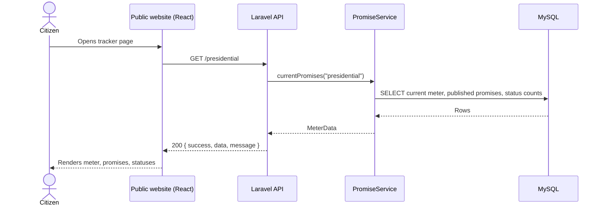
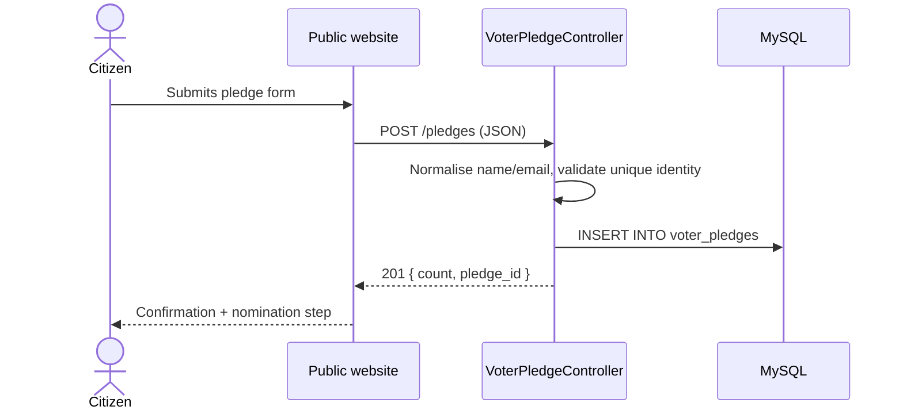
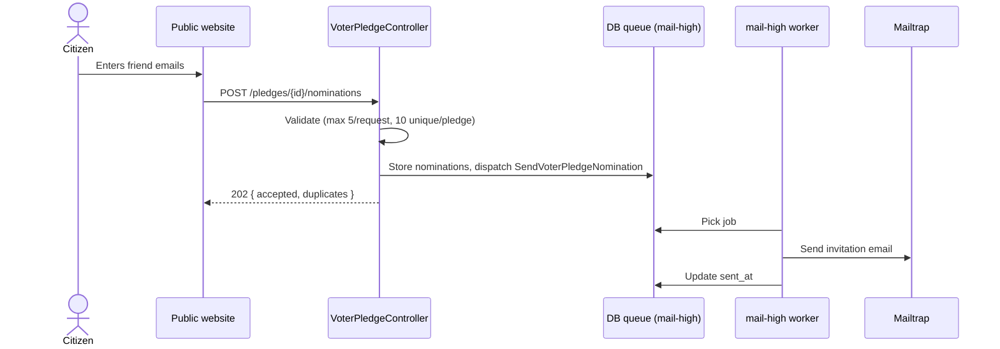
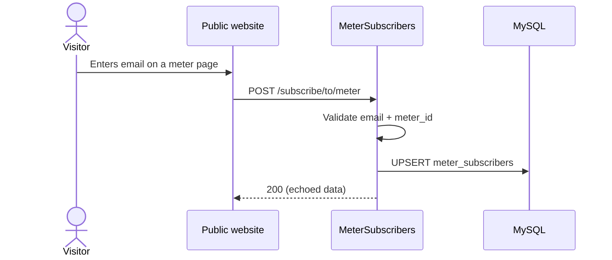
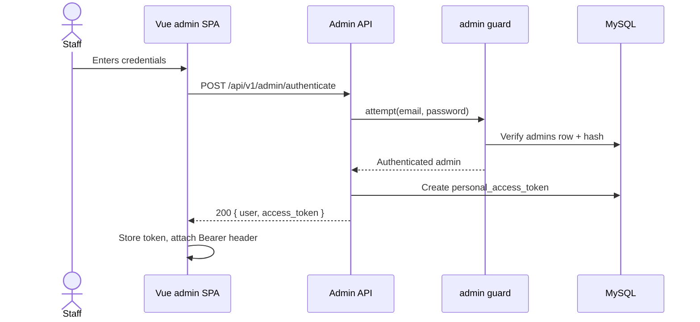
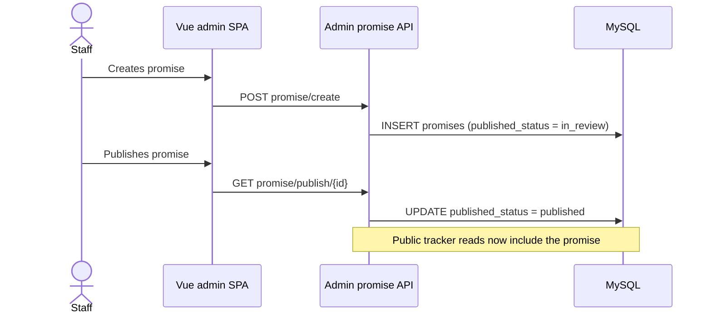
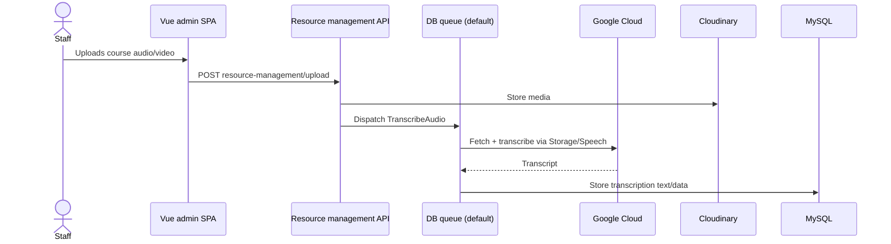
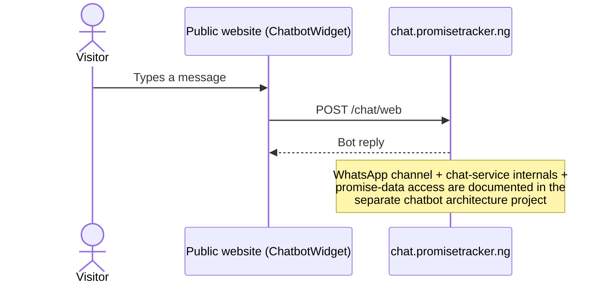

# Promise Tracker — Data Flows

Accurate as of: 2026-09-11
Scope: technical data exchange across the public website, the Laravel API, MySQL, queue workers, and external services. This is the dedicated data-flow layer referenced by the [architecture](architecture.md).

**Chatbot boundary:** the web chatbot widget is documented here up to `chat.promisetracker.ng`. The WhatsApp channel, the chat service's internals, and how it accesses promise data are owned by a **separate chatbot project** and are intentionally out of scope for this document.

## Data exchange summary

| # | Flow | Source → Destination | Contract | Payload | Sensitivity |
|---|---|---|---|---|---|
| 1 | Tracker read | Website → API → MySQL | `GET /presidential` etc. ([public API](api/public.md)) | Meter, promises, status counts | Public |
| 2 | Pledge submission | Website → API → MySQL | `POST /pledges` | Name, phone, email, state, LGA, PVC status, consent | **Voter PII** |
| 3 | Nomination emails | API → queue → worker → Mailtrap | `POST /pledges/{id}/nominations` | Nominee email addresses | **Contact PII** |
| 4 | Meter subscription | Website → API → MySQL | `POST /subscribe/to/meter` | Email, meter id | Contact PII |
| 5 | Admin login | Admin SPA → API → MySQL | `POST /api/v1/admin/authenticate` | Credentials; Sanctum token issued | Credentials |
| 6 | Promise publish | Admin SPA → API → MySQL | `POST promise/create`, `GET promise/publish/{id}` | Promise record, `published_status` | Public content |
| 7 | Media transcription | Admin SPA → API → queue → Google Cloud / Cloudinary | Resource-management uploads | Audio/video, transcripts | Internal |
| 8 | Chatbot (web widget) | Website → external chat service | `POST chat.promisetracker.ng/chat/web` | Visitor messages | External — see boundary note |

## Sequence diagrams

### 1. Public tracker read

### 2. Voter pledge submission (PII)

### 3. Nomination emails (queued)

### 4. Meter subscription

### 5. Admin login (Sanctum)

### 6. Promise publish (admin workflow)

### 7. Media transcription (jobs)

### 8. Chatbot web widget (external boundary)

## Storage and queue notes

- All writes go through the Laravel API; no client writes to MySQL directly.
- Queued jobs live in the `jobs` table; the `default` and `mail-high` queues each have a dedicated systemd worker (see [deployment](deployment/README.md)).
- Public reads are filtered by `published_status = published` (promises) and soft-delete exclusion; see the [data model](data/README.md).
