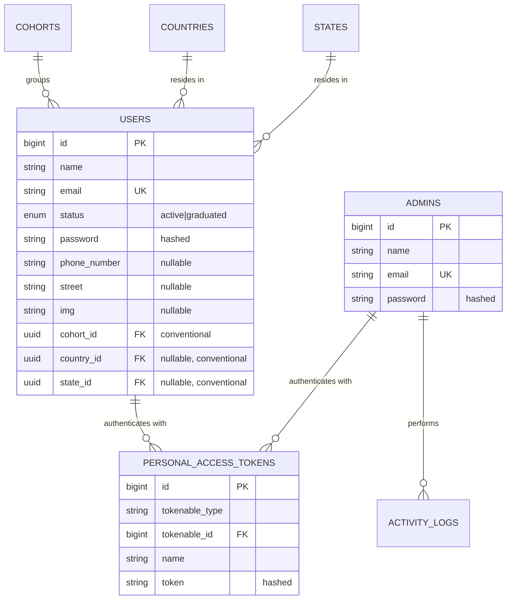

# Data Model — Identity & RBAC

Accurate as of: 2026-09-10

## Entity relationship diagram

## Key tables

| Table | Purpose | Notes |
|---|---|---|
| `admins` | Staff accounts for the Vue admin console | Sanctum `admin` guard; login issues `personal_access_tokens` |
| `users` | Learner accounts (LMS) | Sanctum learner guard; cohort/geography columns are conventional, not enforced FKs |
| `personal_access_tokens` | Sanctum bearer tokens | Polymorphic `tokenable`; both admins and learners hold tokens |
| `password_reset_tokens`, `sessions` | Laravel framework tables | Standard structure |

## Spatie permission tables

`permissions`, `roles`, `model_has_permissions`, `model_has_roles`, `role_has_permissions` follow the standard Spatie Laravel-Permission schema. Their pivot foreign keys **are** enforced. The admin console manages roles, admins, and per-role permissions through `admin-management/*` endpoints.

## Notes

- Admins and learners are separate identity populations with separate guards; only learners appear in the public leaderboard.
- `users.cohort_id`, `country_id`, and `state_id` are UUID columns referencing UUID tables, while `users.id` is a bigint — cross-type relationships are conventional.
