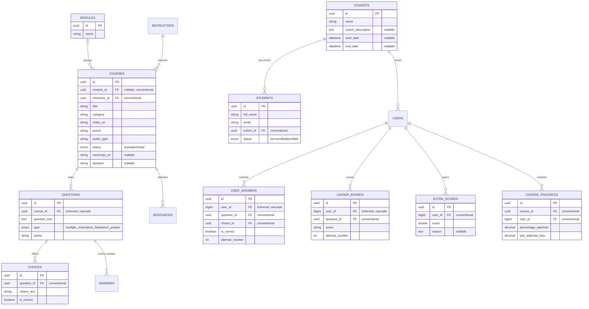

# Data Model — Learning (LMS)

Accurate as of: 2026-09-10

## Entity relationship diagram

## Key tables

| Table | Purpose | Notes |
|---|---|---|
| `courses` | Video/audio courses with points and category | Transcription columns added later; `status` supports archive/restore |
| `questions` / `choices` / `answers` | Quiz bank | `questions.course_id` is one of only four enforced FKs; choices and answers are conventional |
| `user_answers` | A learner's answer per question per attempt | `user_id` enforced; question/choice conventional |
| `leader_boards` | Per-question scores feeding the leaderboard | `user_id` enforced; leaderboard sums latest attempt + extra scores |
| `extra_scores` | Manually awarded points | Admin adds/removes via `students/add-points` and `remove-extra-point` |
| `course_progress` | Watch progress per user per course | `percentage_watched >= 90` counts as completed |
| `cohorts` / `students` | Cohort management and pre-enrolment rosters | `students` are invite-stage records, distinct from enrolled `users` |
| `student_migration_logs` | Audit of cohort migrations | All three FKs are commented out — conventional only |

## Leaderboard computation

The public top-students query sums each learner's **latest attempt** scores in `leader_boards`, adds `extra_scores`, counts courses with `percentage_watched >= 90` as `completed_courses`, and filters to `users.status = active`.
