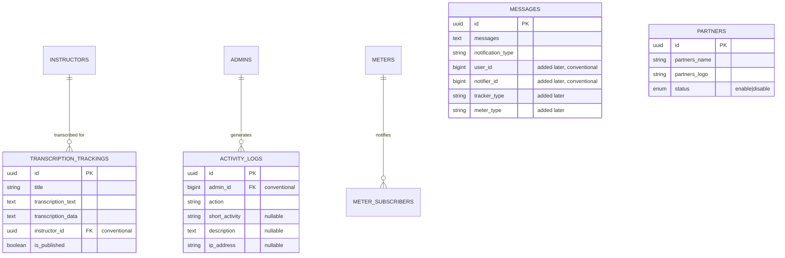

# Data Model — Media & Operations

Accurate as of: 2026-09-10

## Entity relationship diagram

## Key tables

| Table | Purpose | Notes |
|---|---|---|
| `media` | Media library attachments | Standard structure from the 2020 media package migration |
| `transcription_trackings` | Google Speech transcription results | Full text and raw data; linked to instructors conventionally |
| `messages` | In-app notifications | Columns appended across four later migrations (`user_id`, `notifier_id`, `tracker_type`, `meter_type`) |
| `activity_logs` | Admin audit trail | Exported via `admin-management/activity-logs/export`; `admin_id` not an enforced FK |
| `partners` | Partner logos on the public site | Public API exposes `status = enable` only |
| `meter_subscribers` | Meter update subscribers | Covered in [voter-engagement.md](voter-engagement.md) — email is contact PII; no unique constraint |
| `jobs`, `failed_jobs`, `job_batches` | Database queue | Workers run via systemd (`deploy/systemd/`) |
| `cache`, `cache_locks`, `sessions` | Laravel framework | Database cache and cookie sessions per runtime config |

## Notes

- Uploads flow to Cloudinary; audio transcription uses Google Cloud Storage + Speech and lands in `transcription_trackings` and course columns.
- Activity logs record admin actions with IP addresses — operational data with privacy implications; treat access as auditable.
