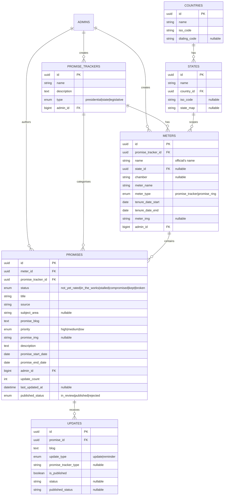

# Data Model — Promise Tracking

Accurate as of: 2026-09-10

## Entity relationship diagram

**None of the relationships above are enforced by database foreign keys** — all `FK` markers are conventional. Orphaned rows are possible; the service layer is the only guard.

## Key tables

| Table | Purpose | Notable columns |
|---|---|---|
| `promise_trackers` | Top-level tracker per office type | `type` enum; one presidential, state, or legislative tracker owns many meters |
| `meters` | A rated "meter" for an official or body | `meter_type` distinguishes tracker meters from Promise Ring meters; `state_id`/`chamber` scope it; tenure dates pick the *current* presidential meter |
| `promises` | A single tracked promise | Six-value `status`; `published_status` gates public visibility (`in_review` default, `published`, `rejected`) |
| `updates` | Promise updates and reminders | `update_type` splits updates from reminders; `promise_tracker_type` powers the public reminders feed |

## Invariants the application relies on

- A promise is public only when `published_status = published` and not soft-deleted.
- The *current* presidential meter is the one whose tenure dates bracket today.
- Promise Ring meters are `meter_type = promise_ring` scoped to a state; tracker meters are `promise_tracker`.
- Status counts on the public site are computed from published promises only.
