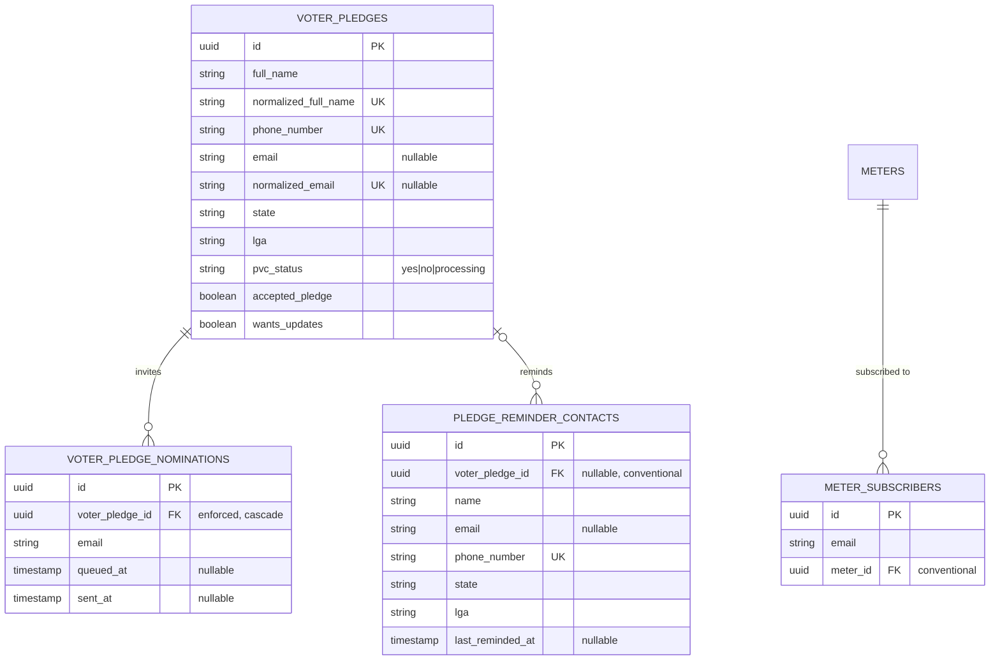

# Data Model — Voter Engagement (PII)

Accurate as of: 2026-09-10
Classification: **Highest-sensitivity PII** — full names, phone numbers, emails, state/LGA, PVC status, and consent flags.

## Entity relationship diagram

## Key tables

| Table | Purpose | Integrity notes |
|---|---|---|
| `voter_pledges` | A citizen's pledge-to-vote submission | Unique on `phone_number`, `normalized_full_name`, and `normalized_email` (nullable). Normalisation trims, collapses whitespace, and lower-cases. |
| `voter_pledge_nominations` | Friends a pledger invited | **Only enforced FK in this domain** (`voter_pledge_id`, cascade delete). Unique `(voter_pledge_id, email)`; `queued_at`/`sent_at` track delivery. Max 10 unique emails per pledge enforced in the controller. |
| `pledge_reminder_contacts` | Reminder contact roster | `voter_pledge_id` is nullable and **not** a foreign key; `phone_number` is unique; state/LGA indexed. |
| `meter_subscribers` | Email subscribers to a meter | **No unique `(email, meter_id)`** — dedup is application-level via `updateOrCreate` only. |

## Privacy handling

- These tables are written by public endpoints but never exposed by public reads.
- Consent is explicit: `accepted_pledge` must be true; `wants_updates` gates future contact.
- Nominations store only an email address, with delivery state tracked for the queue.
- Any export, analytics, or admin viewing of these tables is a PII access event and should be logged.
