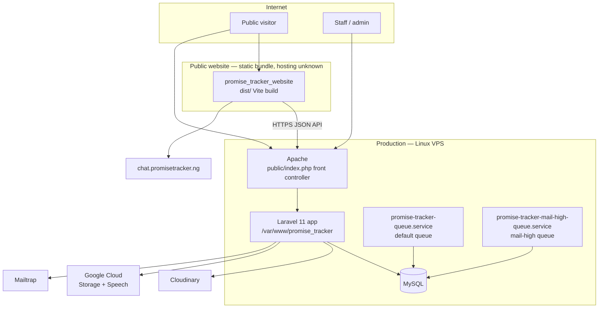

# Promise Tracker — Deployment

Accurate as of: 2026-09-11
Scope: the current production shape and the agreed v1 target ([ADR-0004](../adr/0004-keep-deployment-shape-defer-containerization.md)). Overview depth — this is not yet a full runbook.

## Current topology



## Components

| Component | Responsibility | Evidence |
|---|---|---|
| Apache | Serves the Laravel app via `public/index.php` and `.htaccess` rewrites | `promise_tracker/public/` |
| Laravel app | API, admin SPA, learner services, queue dispatch | `promise_tracker/app/` |
| MySQL | Primary datastore; also holds queue jobs, cache, sessions | `.env` runtime config, migrations |
| `promise-tracker-queue.service` | Default-queue worker (`--queue=default`) | `deploy/systemd/promise-tracker-queue.service` |
| `promise-tracker-mail-high-queue.service` | High-priority mail worker (`--queue=mail-high`) | `deploy/systemd/promise-tracker-mail-high-queue.service` |
| Public website | Static React bundle calling the production API | `promise_tracker_website/dist/` |

Both workers run as `www-data` from `/var/www/promise_tracker` with `--tries=3 --timeout=120 --max-time=3600`, `Restart=always`, and a 30-second stop timeout.

## Runtime requirements

- PHP `^8.2` (required by the locked Laravel 11 framework; the local machine has only 8.1 — see gaps)
- Composer dependencies, MySQL, and the PHP extensions implied by `composer.json`
- Node.js + Vite for building both frontends

## Environments

| Environment | Status | Notes |
|---|---|---|
| Production | Live | API/admin at `admin.promisetracker.ng`; public website consumes `/api/v1/promise-tracker` |
| Local | Degraded | PHP 8.1 cannot pass the vendor platform check, so `artisan` and tests cannot run; `.env` sets `APP_ENV=local` while pointing `APP_URL` at production |

## Configuration

Configuration keys in `.env` (values are secrets — never document them here):

| Group | Keys |
|---|---|
| App | `APP_NAME`, `APP_ENV`, `APP_KEY`, `APP_DEBUG`, `APP_URL`, `APP_LOCALE`, `APP_TIMEZONE`, `APP_MAINTENANCE_DRIVER` |
| Database | `DB_HOST`, `DB_PORT`, `DB_DATABASE`, `DB_USERNAME`, `DB_PASSWORD` |
| Queue / cache / session | `QUEUE_CONNECTION`, `CACHE_STORE`, `CACHE_PREFIX`, `SESSION_DRIVER`, `SESSION_DOMAIN`, `SESSION_ENCRYPT`, `SESSION_LIFETIME` |
| Mail | `MAIL_MAILER`, `MAILTRAP_HOST`, `MAIL_API_KEY`, `MAIL_FROM_*`, `PROMISE_NOTIFICATION_EMAIL` |
| Cloudinary | `CLOUDINARY_URL`, `CLOUDINARY_UPLOAD_PRESET`, `CLOUDINARY_NOTIFICATION_URL` |
| Broadcast | `BROADCAST_DRIVER`, `BROADCAST_CONNECTION`, `PUSHER_*`, `MIX_PUSHER_*` |
| Cloud storage | `AWS_*` (present; local filesystem is the active disk), `REDIS_*` (present; database queue/cache active) |
| Domain | `DEFAULT_COUNTRY`, `LEARNING_URL` |

### Config drift (known defects)

1. `config/broadcasting.php` reads `BROADCAST_DRIVER`, while `.env` sets `BROADCAST_CONNECTION` — real-time broadcasting silently stays in `log` mode.
2. The `CLOUDINARY_URL` value contains a doubled `CLOUDINARY_URL=` prefix.
3. `APP_ENV=local` alongside a production `APP_URL`.

## Queue workers

Install and operate (from `deploy/systemd/README.md`):

```bash
sudo cp /var/www/promise_tracker/deploy/systemd/promise-tracker-queue.service /etc/systemd/system/
sudo cp /var/www/promise_tracker/deploy/systemd/promise-tracker-mail-high-queue.service /etc/systemd/system/
sudo systemctl daemon-reload
sudo systemctl enable --now promise-tracker-queue
sudo systemctl enable --now promise-tracker-mail-high-queue
```

```bash
sudo systemctl status promise-tracker-queue promise-tracker-mail-high-queue
sudo journalctl -u promise-tracker-queue -f
sudo journalctl -u promise-tracker-mail-high-queue -f
```

Jobs on `mail-high`: voter pledge nominations, meter-subscriber notifications, promise notification emails.

## Build & release

- Backend admin SPA: `npm run build` (Vite) → `promise_tracker/public/build/`
- Public website: `npm run build` (Vite) → `promise_tracker_website/dist/`
- No CI pipelines exist at either app root; deployment appears manual.
- Built artifacts are committed in-tree, along with SQL dumps — a hygiene gap the monorepo `.gitignore` will address.

## Observability

- Laravel application logs (service code uses `Log::info` on errors)
- `journalctl` for both queue workers
- `activity_logs` table records admin actions with IP addresses
- No centralized monitoring, alerting, or uptime checks are evidenced in the repo

## Deployment checklist (overview depth)

1. **Pre-deploy** — back up the database; verify `.env`; build both frontends; run the PHPUnit suite (requires PHP 8.2)
2. **Deploy** — sync code; `composer install --no-dev`; run migrations; restart both queue workers
3. **Verify** — `GET /up` health check; one public tracker read; admin login; one queue job processed
4. **Rollback** — **currently impossible**: the backend has no version control. This is the single biggest deployment risk and is fixed by the monorepo ([ADR-0001](../adr/0001-adopt-root-monorepo.md))

## Target deployment (v1)

The same shape, de-drifted:

- Root monorepo with hygiene `.gitignore` before the first commit; versioned, reversible releases
- Real `.env.example`; Google credentials loaded via an env-configured path, not a repo file
- PHP constraint `^8.2`; broadcast variable aligned; `CLOUDINARY_URL` fixed
- Containerisation remains deferred with explicit reopening triggers ([ADR-0004](../adr/0004-keep-deployment-shape-defer-containerization.md))
