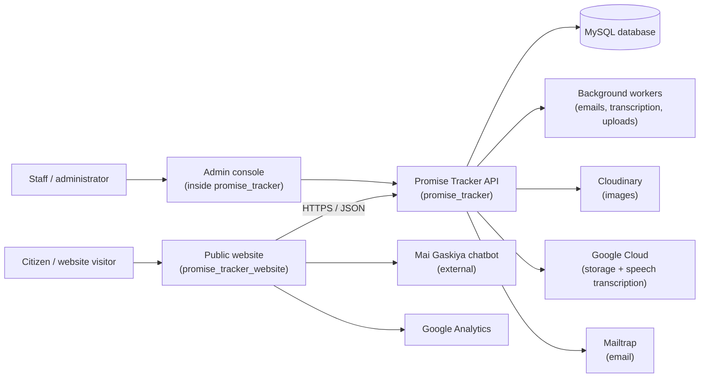

# Promise Tracker — System Overview

Accurate as of: 2026-09-10
Audience: everyone, including non-technical stakeholders

## What Promise Tracker is

Promise Tracker is a Nigerian public-accountability platform, run by the AdvoKC Foundation. It tracks campaign promises made by elected officials — the President, members of the National Assembly (Senate and House of Representatives), and state governors — and records whether each promise is kept, broken, stalled, still in the works, compromised, or not yet rated.

Citizens can read tracking articles, view promise ratings on meters for each office, browse the Promise Ring, follow the student leaderboard, and join email or pledge campaigns around elections.

The platform has three main parts:

1. **The public website** (`promise_tracker_website`) — a React application where citizens browse promises by tracker (presidential, state, legislative), read promise details and updates, explore the state-by-state Promise Ring, pledge to vote, invite friends, and see the leaderboard.
2. **The backend and admin console** (`promise_tracker`) — a Laravel application that stores all data, exposes the public API the website calls, serves learner services (courses, quizzes, dashboard, leaderboard), and embeds the staff-facing admin console used to manage promises, trackers, meters, students, cohorts, courses, quizzes, instructors, partners, analytics, notifications, and pledges.
3. **The database and workers** — a MySQL database plus background queue workers that handle slower jobs such as sending nomination and reminder emails and transcribing uploaded audio.

## Who uses it

| Who | What they do | Where |
|---|---|---|
| Citizens / website visitors | Browse trackers, promises, Promise Ring, leaderboard; pledge to vote; nominate friends; subscribe to meter updates; chat with the Mai Gaskiya chatbot | Public website |
| Staff / administrators | Manage promises, meters, trackers, students, cohorts, courses, quizzes, instructors, partners, media, notifications, pledges | Admin console |
| Learners / students | Take courses and quizzes; appear on the student leaderboard | Learner services + public website |

## How the pieces fit

## What it does today

- **Promise tracking** — promises are organised by tracker type (presidential, state, legislative) and meter, each with one of six statuses (`not_yet_rated`, `in_the_works`, `stalled`, `compromised`, `kept`, `broken`), plus published updates over time.
- **Promise Ring** — a state-by-state view of published promises and their status counts.
- **Voter engagement** — citizens pledge to vote (full name, phone number, state, LGA, PVC status, consent), invite friends via nominations (up to five per request and ten unique per pledge), and subscribe to meter updates by email.
- **Learning** — learner, cohort, course, quiz, and instructor modules with a student leaderboard.
- **Media** — uploads to Cloudinary; audio transcription through Google Cloud Storage and Speech.
- **Communications** — transactional email through Mailtrap; real-time broadcast is configured (Pusher) but currently runs in log mode.

## Current status, in plain language

The platform is live: the public website calls the production API at `https://admin.promisetracker.ng/api/v1/promise-tracker`. The codebase is substantial and real: 50+ database migrations, a large API and service layer, background jobs, and a small PHPUnit suite.

Three serious problems are known and accepted as the first things to fix:

1. **The local backend copy is missing its route files.** Laravel expects `routes/web.php`, `routes/api.php`, and `routes/console.php`; they are absent and cannot be recovered from local history. The agreed fix is to reconstruct them from the website's calls, the backend controllers, and the tests — clearly marked as inferred — unless the originals can be recovered from production.
2. **The backend has no version-control history.** Only the website is a real Git repository. The agreed fix is a single root monorepo containing both applications and these docs, with secrets ignored before the first commit.
3. **Credentials sit in plain files on disk.** A real `.env`, a Google service-account JSON, and a mail token are present in the tree. The agreed fix is a scoped hygiene pass — ignore them, provide a safe `.env.example`, and load the service-account path from configuration. Git history sanitisation is a separate follow-up.

A fourth practical constraint: the local machine only has PHP 8.1, while the backend requires PHP 8.2 to run its test suite. Route reconstruction will therefore be marked "pending test verification" until PHP 8.2 is available.

## Where to go next

- [Architecture](architecture.md) — the full current-state, target-state, and gap analysis.
- [Decisions](adr/) — the accepted architecture decisions and their reasoning.
