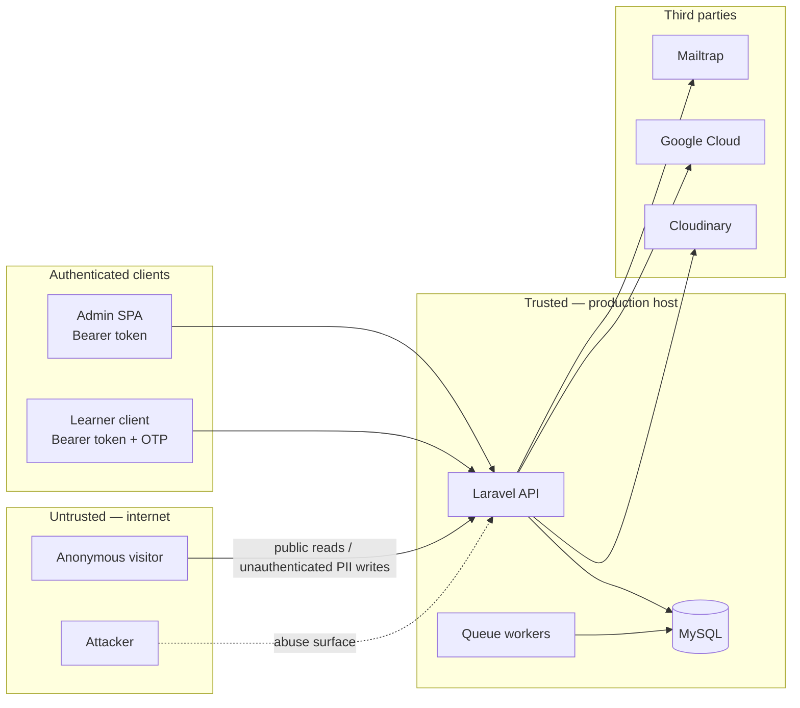

# Promise Tracker — Security & Threat Model

Accurate as of: 2026-09-11
Approach: pragmatic — trust boundaries, data flows, the auth/authz model, and top risks with severity. Not a formal per-component STRIDE audit.

## Assets (by sensitivity)

See the [data classification](../data/README.md) for the full breakdown.

1. **Voter PII** — `voter_pledges`, `pledge_reminder_contacts`, `voter_pledge_nominations` (names, phones, emails, state/LGA, PVC status, consent)
2. **Credentials** — admin/learner password hashes, Sanctum tokens, sessions, and third-party keys (Cloudinary, Google, Mailtrap, Pusher, AWS)
3. **Learner PII** — `users`, `students` (names, emails, phones, images, addresses)
4. **Public content** — trackers, meters, published promises and updates

## Actors

| Actor | Trust level | Access |
|---|---|---|
| Anonymous visitor | Untrusted | Public reads; unauthenticated writes (pledges, nominations, meter subscriptions) |
| Attacker | Untrusted | Same surface as a visitor |
| Admin (staff) | Semi-trusted after login | Sanctum token + Spatie role/permissions |
| Learner | Semi-trusted after login/OTP | Learner services (client unknown — see [learner API](../api/learner.md)) |
| Queue workers | Trusted system | Database queue, mail dispatch |
| Third parties | External | Cloudinary, Google Cloud, Mailtrap, chatbot |

## Trust boundaries

## Authentication & authorisation model

| Surface | Auth | Authorisation | Confidence |
|---|---|---|---|
| Public API | None | Published/enabled rows only; validation and business limits | High — controllers verified |
| Admin API | Sanctum bearer token, `admin` guard, CSRF-cookie bootstrap | Spatie roles/permissions | Medium — routes missing, so per-route middleware is unverifiable |
| Learner API | Sanctum + OTP flow | Learner guard | Low — controllers exist, client and routes unknown |

**Blocked verification:** with `routes/` missing, no route's middleware, throttling, or guard can be confirmed. Route reconstruction ([ADR-0003](../adr/0003-reconstruct-missing-route-files.md)) is a security prerequisite, not just a functional one.

## PII flows

1. **Pledge submission** — public POST `/pledges` writes voter PII directly to `voter_pledges`. Identity guards: unique phone, normalised name, normalised email.
2. **Nomination emails** — public POST queues invitations; emails travel through Mailtrap. Limits: 5 per request, 10 unique per pledge.
3. **Meter subscription** — public POST upserts contact emails; no DB unique constraint (race-risk duplicates).
4. **Admin PII access** — pledge dashboard, heatmap, reminder contacts, and exports expose voter PII to authenticated admins; `activity_logs` should record these accesses.

## Top risks

| # | Risk | Severity | Impact | Remediation |
|---|---|---|---|---|
| 1 | Credentials in plain files on disk (real `.env`, Google service-account JSON, Postmark token in `mail.sh`) | **Critical** | Third-party account compromise | Hygiene pass; move to env-configured paths; rotate exposed credentials; separate history-sanitisation follow-up |
| 2 | Backend has no version control | **Critical** | No audit trail, no rollback, unauditable changes | Root monorepo ([ADR-0001](../adr/0001-adopt-root-monorepo.md)) |
| 3 | Route files missing | **Critical** | Auth/throttle middleware unverifiable; app cannot route | Reconstruct routes ([ADR-0003](../adr/0003-reconstruct-missing-route-files.md)); audit middleware before merge |
| 4 | Unauthenticated public PII writes; rate limiting unverified | High | Spam, enumeration, PII flooding | Keep identity limits; add throttling to pledge/nomination/subscribe routes during reconstruction |
| 5 | PHP 8.1 locally (EOL for security fixes since Dec 2025); production version unknown | High | Unpatched runtime risk | Standardise on PHP 8.2; confirm production version |
| 6 | `meter_subscribers` lacks unique `(email, meter_id)` | Medium | Duplicate PII rows under race | Add a migration with a unique index |
| 7 | Config drift (broadcast variable, doubled `CLOUDINARY_URL`, env mismatch) | Medium | Silent misconfiguration | De-drift in the hygiene pass |
| 8 | Minimal automated tests (9 methods; all feature tests blocked by missing routes) | Medium | Auth/validation regressions ship unnoticed | Testing strategy below; tests green before any refactor |
| 9 | No documented PII retention/deletion or access-logging policy beyond the privacy policy | Medium | Over-retention, unlogged access | Define retention; log admin PII exports |

## Security roadmap (ordered)

1. Hygiene pass: `.gitignore`, `.env.example`, env-configured Google credentials, rotate exposed keys
2. Monorepo baseline — never commit secrets
3. PHP 8.2 everywhere; confirm the production runtime
4. Route reconstruction with a middleware audit (auth, throttle, guards)
5. Add rate limiting to public writes
6. Unique index for `meter_subscribers`
7. PII access logging and a retention policy
