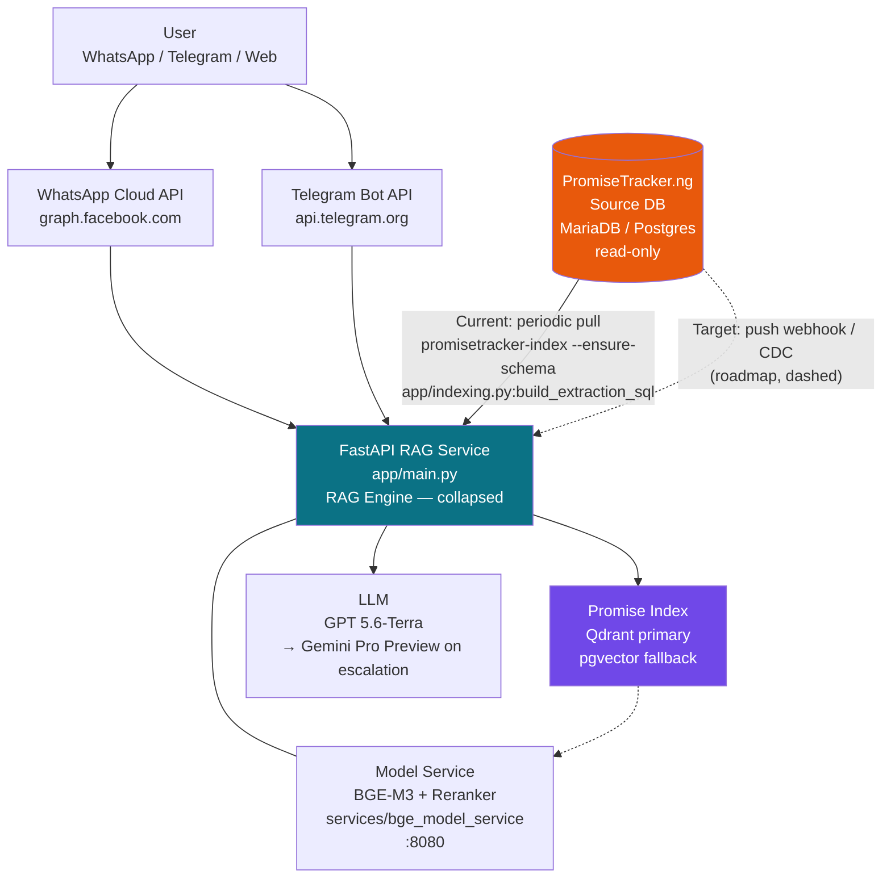
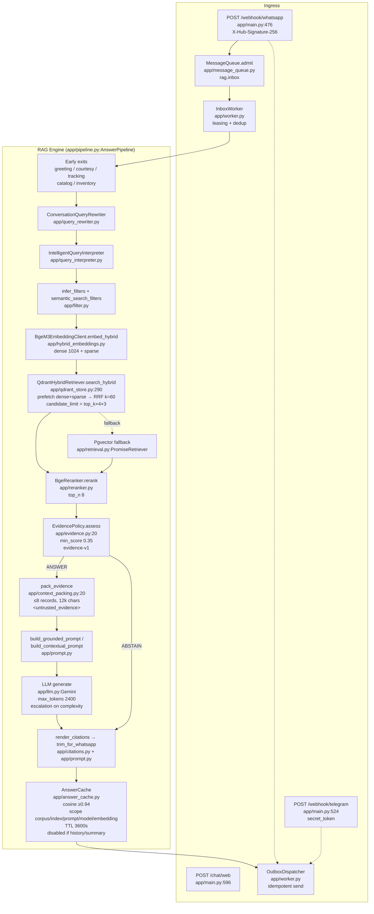

# PromiseTracker RAG — System Architecture

> The [unified architecture](../docs/architecture.md) governs the accepted cross-system target as of 2026-10-09. Claims below, including model choice and runtime wiring, need source verification; see its reconciliation table.

> **Scope:** This document covers **only the RAG chatbot** (`app/`). The PromiseTracker.ng web platform / CMS is external and treated as the single **source of truth database**. Its internal architecture lives elsewhere. Reads are **one-way, read-only**: RAG never writes back to the source.

## Executive Summary (for partners / funders)

**Problem:** Citizens ask natural-language questions on WhatsApp/Telegram about Nigerian political promises. Answers must be traceable to verified records on [promisetracker.ng](https://promisetracker.ng), not hallucinated.

**Guarantee:** Every answer is **cited or the bot abstains**.

```
User question → Retrieve candidate promises → Re-rank by relevance → Gate (score ≥ 0.35) → Cite [E1] with clickable link or reply "I don't have verified information"
```

* **Retrieve** — hybrid lexical + semantic search across all indexed promises.
* **Re-rank** — cross-encoder (BGE reranker) scores each candidate in the context of the question.
* **Gate** — `app/evidence.py:20` (`EvidencePolicy`, `evidence-v1`). If no record scores `≥ 0.35` the pipeline short-circuits to an abstention response via `app/prompt.py:format_no_data_answer`.
* **Cite or abstain** — evidence is packed as `<untrusted_evidence handle="E1">` (`app/context_packing.py:20`). The LLM is instructed to cite only `[E1]`-style handles, rendered to real `source_url`s by `app/citations.py`. No evidence above the gate → no LLM call, deterministic `I don't have verified information … see promisetracker.ng` reply.

The bot **cannot invent a promise**. If the index has no matching record, it says so.

**Freshness commitment:**

| Path | Staleness | How |
|---|---|---|
| **Current (solid)** | Periodic pull, configurable `SOURCE_SYNC_INTERVAL_SECONDS` (`app/settings.py:130`, default 300s) | `promisetracker-index` batch job reads source DB and upserts vectors |
| **Target (dashed)** | Near-real-time push | Source DB change → webhook / CDC event → on-demand re-index (roadmap, not yet default) |

Do not promise sub-minute freshness until the dashed path is deployed and monitored.

---

## Container View (C4 Level 2) — External

Shows what a partner sees: 5 boxes, one collapsed engine.



**Read the collapsed box as:** *"All retrieval, ranking, gating, citation, caching and durability lives inside RAG Engine — see Appendix."*

### Trust inset — funnel (render alongside container)

```mermaid
flowchart LR
    Q[Question] --> H[Hybrid retrieval<br/>Qdrant prefetch dense+sparse<br/>RRF k=60]
    H --> R[Re-rank<br/>BGE reranker v2-m3<br/>top_n=8]
    R --> G{Gate<br/>min_score 0.35<br/>app/evidence.py:26}
    G -- "≥0.35" --> C[Cite [E1] → promisetracker.ng URL]
    G -- "<0.35 / empty" --> A[Abstain<br/>no LLM call]
```

**Key invariants for external reviewers:**

1. Rating fidelity — `Not yet rated / Kept / Stalled / Compromised / Broken / In the works` are rendered **verbatim** from `PromiseRecord.status` (`app/models.py:104`). "Broken" is never paraphrased as "Compromised".
2. Citations are mandatory — `app/prompt.py` + `app/citations.py:render_citations` replace `[E1]` with the real `source_url` from `app/url_utils.py:source_url_for_record`. Answers without `[E1]` after rendering are treated as incomplete (`app/pipeline.py:939`).
3. Evidence is untrusted — prompt packs records into `<untrusted_evidence handle="E1">` blocks (`app/context_packing.py:133`). Model is instructed *not* to use outside knowledge.

---

## Appendix — Expanded RAG Engine (for engineers)

Only this section requires code familiarity. Keep it out of funder decks.



### Durability & privacy (collapsed in main diagram)

* **Durable ingress** (`app/settings.py:111` `durable_ingress=true`): webhook → `rag.inbox` via `MessageQueue` (`app/message_queue.py`), `InboxWorker` leases (`SELECT … FOR UPDATE SKIP LOCKED`), idempotency key `sha256(channel:external_message_id:answer-v1)` (`app/main.py:231`), answer → `rag.outbox`, `OutboxDispatcher` delivers with retry classification (`app/main.py:288`). Restart-safe; prevents message loss. Concurrency bounded by `asyncio.Semaphore(message_processing_concurrency=20)` (`app/main.py:129`) and `asyncpg.Pool` (`app/db.py`).
* **Rate limiting:** `PostgreSQLRateLimiter` (`app/rate_limit.py`) 20/min per sender (`app/settings.py:110`), with `PooledPostgreSQLRateLimiter` bridging the pool in `app/main.py:90`.
* **Pseudonymization:** `HMACPseudonymizer` (`app/privacy.py`, `privacy-v1` at `app/settings.py:50`) over sender/message IDs before `rag.conversation_turns` insert; ciphertext via `pgp_sym_encrypt` (`app/main.py:978`). Plaintext only if no HMAC key (local).
* **Correlation:** `x-request-id` middleware (`app/observability.py`) propagated through `structured_event`.
* **Health:** `/ready` checks `rag.schema_migrations`, `rag.inbox`, `rag.index_versions active` (`app/main.py:370`) and Qdrant + model `/health` (`app/main.py:423`).

### Indexing detail

* **Source extraction:** `app/indexing.py:41` `build_extraction_sql(settings)` joins `promise_source_table` / `promise_*_column` settings (`app/settings.py:119`) or explicit `promise_extraction_sql`. Default `ORDER BY updated_at DESC, id DESC` supports incremental pulls.
* **Embedding text** (`app/indexing.py:27` / `app/qdrant_store.py:387`):
  ```
  Title: {title}
  Description: {description}
  Status: {status}
  Category: {category}
  Region: {region}
  Politician/Admin: {politician}
  Date: {date_text}
  ```
* **Upsert paths:**
  * `POST`-live (preferred): `fetch_source_promises` → `QdrantClient.index_records` with `BgeM3EmbeddingClient.embed_hybrid` batch 32 (`app/qdrant_store.py:191`) → `ensure_collection` (`dense Cosine 1024` + `sparse`) → `upsert` (`app/qdrant_store.py:142`) + optional `rag.promise_embeddings` mirror via `app/vector_store.py:upsert_embedded_records` + `rag.index_versions` promotion (`app/cli.py:177` `register_active_qdrant_index`).
  * Legacy/offline: `promisetracker-index --from-embedded data/promise_tracker_rag/embedded/embedded_records.json` (`app/cli.py:65`, `app/vector_store.py`), union with `meter_reports_embedded`.
* **Qdrant storage model** (`app/qdrant_store.py:334` `_point`): `id = uuid5(NAMESPACE_URL, "promisetracker:{promise_id}")`, payload mirrors `PromiseRecord` fields plus normalized `metadata` (`app/taxonomy.py:normalize_taxonomy_metadata`), casefolded filter keys; vectors `{dense, sparse.indices/values}`.
* **Index promotion:** `rag.index_versions.version` (`app/settings.py:108` `index-v3-promise-ring`) set to `active`, previous `active` → `retired` (`app/cli.py:189`).

### Operational notes

* Compose: `qdrant` (`qdrant/qdrant:v1.18.2`), `models` (`services/bge_model_service`), `api` (FastAPI), `indexer` (profile `index`, `command: ["promisetracker-index","--ensure-schema"]`, `restart: no`) in `docker-compose.yml:1`. Model cache volume `model_cache:/models`, health on `GET /health` (`ready:true`).
* Defaults: `retrieval_backend=qdrant` (`app/settings.py:82`), `retrieval_top_k=40`, `reranker_top_n=8`, `reranker_min_score=0.35`, `retrieval_candidate_multiplier=4`, `retrieval_expansion_factor=3`, `answer_cache_min_score=0.94`.
* Migration safety: immutable SQL in `migrations/` with checksums + advisory locks via `app/migrations.py:apply_migrations`; CI should run `promisetracker-schema-check` and fail on `PromiseRecord` ↔ `rag.promise_embeddings` drift.

