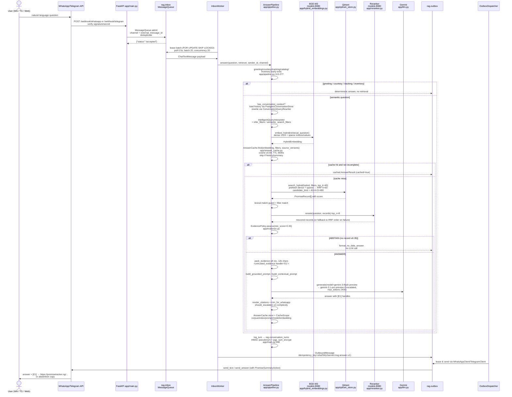
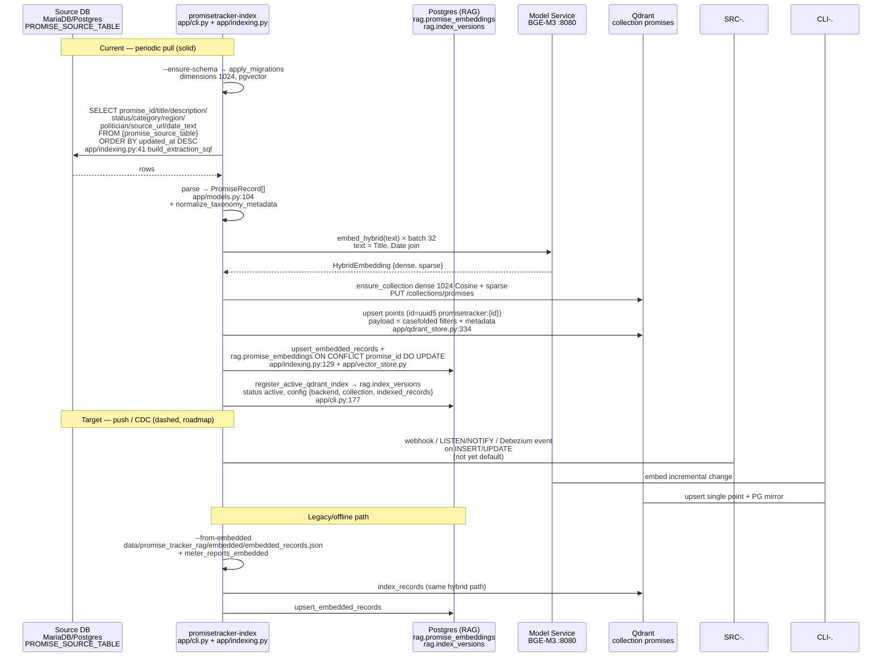
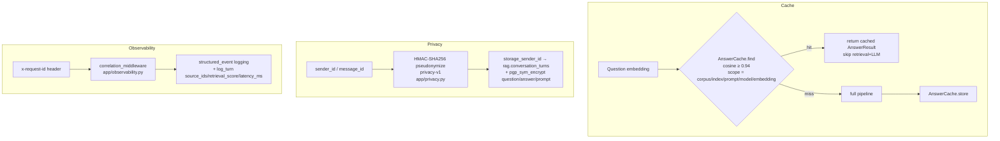

# PromiseTracker RAG — Data Flows

> Companion to `docs/architecture.md`. Container shows **where**; this page shows **how bits move** in time.

## 1) Query Flow — WhatsApp / Telegram / Web → Answer

End-to-end retrieval-augmented generation. The dashed paths are early exits that skip the LLM.

**Payloads on the wire:**

* **Inbound:** `ChatTextMessage` (`app/models.py:7`) — `channel`, `message_id`, `sender_id`, `text`, `timestamp`.
* **Embedding text → Qdrant:** `Title/Description/Status/Category/Region/Politician/Admin/Date` join (`app/indexing.py:27`, `app/qdrant_store.py:387`).
* **Retrieval filters:** `RetrievalFilters` (`app/models.py:126`) — `region/status/category/meter_name/promise_tracker_name/collection_name/collection_member[_type]/document_type/topic_terms` → `qdrant_filter` casefolded match (`app/qdrant_store.py:22`).
* **Outbound answer:** `AnswerResult` (`app/models.py:145`) — `answer` (already citation-rendered), `sources: PromiseRecord[]`, `model`, `escalated`, `cached`, `retrieval_score`, `actions: PromiseSummaryAction[]` (`app/models.py:25`) rendered as WhatsApp interactive buttons / Telegram inline keyboards (`app/interactions.py:build_summary_actions`).

**Abstention copy (what partners audit):**

> Deterministic via `app/prompt.py:format_no_data_answer` + `format_empty_inventory_answer`. Example: *"I don't have verified information on this in our tracked promises. Explore all promises at https://promisetracker.ng."* No `[E1]` links appear in abstention. The branch is taken **without an LLM call** when `EvidenceDecision.ABSTAIN` (`app/evidence.py:7`).

---

## 2) Indexing Flow — Source DB → Promise Index

One-way, read-only. The RAG service owns the copy; the source is never mutated.

**What's indexed (and therefore citable):**

| Field | Source → `PromiseRecord` → Qdrant payload / PG column |
|---|---|
| `promise_id` | `promise_id_column` (`id`) → `PromiseRecord.promise_id` → `payload.promise_id`, PK `rag.promise_embeddings.promise_id`, Qdrant `id = uuid5(...)` |
| `title` | `promise_title_column` → `title` → `payload.title` |
| `description` | `promise_description_column` → `description` → part of embedding text + `<untrusted_evidence>` |
| `status` | `promise_status_column` → `status` (verbatim `Broken` etc.) → casefolded filter `status`, rendered as `Status:` in evidence |
| `category` | `promise_category_column` → `category` |
| `region` | `promise_region_column` (`state`) → `region` |
| `politician` | `promise_politician_column` (`politician_name`) → `politician` |
| `source_url` | `promise_source_url_column` → `source_url` → `Source URL:` in evidence + final clickable link |
| `date_text` | `COALESCE(updated_at, created_at)::date::text` (`app/indexing.py:88`) → `date_text` |
| `metadata` | `normalize_taxonomy_metadata` (`app/taxonomy.py`) → `tracker_name/collection_*/branded_meter_name/meter_kind/document_type/taxonomy_version/corpus_version/index_version/content_checksum/parent_id/chunk_id` → filterable Qdrant payload + `rag.promise_embeddings.metadata::jsonb` |

The **embedded text template** is identical in both Postgres and Qdrant paths — guarantees retrieval parity.

**Operations:**

* Manual: `promisetracker-index --ensure-schema` (once), then `promisetracker-index --ensure-schema --limit 500` or `--from-embedded data/.../embedded_records.json` (`AGENTS.md`).
* Compose one-shot: `docker compose --profile index run --rm indexer` (`docker-compose.yml:82`, `restart: no`).
* Continuous (config-driven): `SOURCE_SYNC_INTERVAL_SECONDS` (`app/settings.py:130`, default 300) is the contract for the future poll loop. Until wired to a scheduler, document the cron you actually run (e.g., systemd timer / K8s CronJob invoking the indexer).
* Health gate: `/ready` requires `rag.schema_migrations` current, `rag.inbox` exists, and one `rag.index_versions` row with `status='active'` (`app/main.py:370`).

---

## 3) Supporting Flows (appendix detail — not in main diagram)

* Cache invalidation is **scope-keyed**, not TTL-only — bumping `corpus_version / index_version / prompt_version` (`app/settings.py:107`) implicitly evicts old answers.
* Conversation memory (`conversation_enabled`) is off by default; when enabled, history is loaded per `channel+sender_id` and rewritten via `ConversationQueryRewriter` before retrieval (`app/pipeline.py:160`).
* Rate limiting and durability are Postgres-backed in production (`rate_limit_backend=postgres`, `durable_ingress=true`); `single_replica_mode` is required for the in-memory limiter (`app/settings.py:284`).

